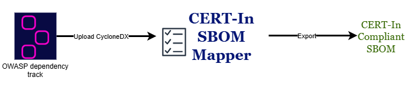
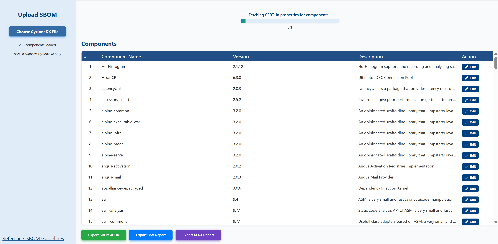

 <span style="font-size: 2em; vertical-align: middle;">CERT-In SBOM Mapper</span>

This project is created to help generate a Software Bill of Materials (SBOM) compliant with the CERT-In technical guidelines. The guideline mandates the following elements included in the SBOM:

- Component Name  
- Component Version  
- Component Description  
- Hashes  
- Vulnerabilities  
- Criticality  
- Timestamp  
- Unique Identifier  
- Component Origin  
- Component Dependencies  
- Patch Status  
- Release Date  
- End-of-Life Date  
- Usage Restrictions  
- Comments or Notes  
- Component Supplier  
- Executable Property  
- Archive Property  
- Structured Property  
- External References  

For detailed guidelines, refer to the official CERT-In document:  
[Technical Guidelines on SBOM by CERT-In](https://www.cert-in.org.in/PDF/TechnicalGuidelines-on-SBOM,QBOM&CBOM,AIBOM_and_HBOM_ver2.0.pdf)

---

## Why CERT-In SBOM Mapper?

While exploring few paid and open-source tools, we found it does not fully satisfy all the minimum elements required by the CERT-In guideline. This tool serves as an addon to existing SBOM generators by adding all missing fields and enables exporting the augmented SBOM in CycloneDX and Excel formats.

---

## Features

- Upload tool-generated CycloneDX SBOM files  
- Edit and complete missing mandatory fields as per CERT-In guidelines  
- Background auto-population for CERT-In properties (Patch Status, Release Date, Criticality, etc.)
- Vulnerabilities from OSV, CISA KEV and EPSS written into the SBOM's `vulnerabilities[]`, with P0–P3 priority
- **Vulnerability Status (VEX)** panel: record the CERT-In section 6 status of each vulnerability (Not affected / Affected / Fixed / Under Investigation) and export **CycloneDX VEX** and a **CSAF 2.0** advisory
- Export dialog with the CERT-In document details: **Author of SBOM Data**, assembly **Timestamp**, the Table 5 **Practices and Processes** declaration, and a **public / private** SBOM (5.3.2)
- Export the updated SBOM in CycloneDX JSON (optionally digitally signed), CSV, Excel and PDF

---

## Getting Started

### Prerequisites

- Node.js (v14 or newer recommended)  
- npm package manager
- Cyclonedx file v1.5

Optional but recommended:
- Create a `.env` file at project root (see below)

### Installation and Running

1. Clone this repository:  
`git clone https://github.com/surajkum4r/CERT-In-SBOM-Mapper`
2. Navigate into the project directory:  
`cd cert-in-sbom-mapper`
3. Install dependencies:  
`npm install`
4. Start the development server:  
`npm start`
5. Open [http://localhost:3000](http://localhost:3000) in your browser.

### Environment (.env)


```
# Enable fetch debug (alerts/logs) while testing
REACT_APP_DEBUG_FETCH=0

# Optional GitHub token; if not set, GitHub is skipped entirely
# REACT_APP_GITHUB_TOKEN=ghp_xxx
```

Notes:
- GitHub is only used for enrichment (stars, forks, repo license) and as a fallback for Release Date; skipping it does not affect Patch Status/Criticality.
- Set `REACT_APP_DEBUG_FETCH=1` while testing to see background fetch alerts and logs.

---

## How it work


1. Export SBOM file from any SCA tool and upload it to OWASP Dependency Track.
2. Export CycloneDX SBOM file and import into CERT-In SBOM Mapper.
3. Upload your tool-generated CycloneDX SBOM file.  
4. The app auto-populates CERT-In properties in the background (batching to avoid rate limits).  
5. Review and optionally edit any fields.  
6. Export the SBOM as JSON, CSV or Excel.

### What gets auto-populated

Values follow the CERT-In Technical Guidelines v2.0 (09.07.2025), Table 5.

| Property | How it is filled |
|---|---|
| Patch Status | Checked against OSV for the component's **exact version**. Shows `Update available (>= X)`, where X is the fix on the component's own release line (Django 4.2.7 → 4.2.30, not 6.x). Prefixed `URGENT - actively exploited (CISA KEV)` when a vulnerability is in CISA's Known Exploited Vulnerabilities catalogue. `No fix available (N known vulnerabilities)` when no fix is published. `NA` when the component could not be checked (never a false "Up to date"). |
| Vulnerabilities | Every finding is added to the exported SBOM's `vulnerabilities[]`, linked to the component (`affects`), with CVSS score, CWE, fix recommendation, CISA KEV status, EPSS exploit probability and a P0–P3 priority. Records for the same flaw from different databases (GHSA / PYSEC / Debian…) are merged under the CVE. |
| Release Date | Release date of **this version** (npm `time[version]`, PyPI release files, deps.dev for Maven/Go/Cargo/NuGet). |
| End-of-Life Date | endoflife.date, matched against its product list, with aliases (e.g. `log4j-core` → log4j, `spring-core` → spring-framework). Shows `Not announced` while a cycle is supported and `Ended (date not published)` when appropriate. Distro packages (deb/rpm/apk) are skipped: the distribution supports them. |
| Criticality | Kept if the SBOM already has one. Otherwise `Critical` if a vulnerability is actively exploited (KEV) or the package is reported malicious, else the highest of the SBOM's own ratings and the OSV severity. The basis is recorded in `cert-in:criticality_basis` and derived values are marked for review. |
| Component Supplier | The supplying **entity**: SBOM `supplier` / registry author, or the purl namespace (Maven groupId, npm scope, Go host org). |
| Component Origin | From the licence: open-source licence → Open-source, proprietary terms → Proprietary. |
| Usage Restrictions | Licence family analysis: permissive / weak copyleft (LGPL, MPL, EPL) / copyleft (GPL) / strong copyleft (AGPL) / restricted use (non-commercial, BUSL). Export control is marked as not assessed. |
| Executable / Archive / Structured | From the component type and package type (a jar/wheel/tgz library is an archive and not executable; an `application`/`container` is executable). |
| Component Description / Licence / Hashes | Written into the component's own CycloneDX fields when the SBOM has none: description and licence from the registry (an SPDX `id` only for real SPDX identifiers, otherwise a licence `name`), hashes of this version's artefact from npm (SHA-512, SHA-1) and PyPI (SHA-256; `cert-in:hash_source` names the file). Existing values are never overwritten. |
| Author of SBOM Data | From the SBOM's `metadata.authors` / manufacturer / supplier, or the author entered in the export dialog. |
| Timestamp | Set to the export time (the SBOM data assembly time); the generator's original time is kept as `cert-in:source_timestamp`. |
| Unique Identifier | The component's purl, kept **valid** so scanners can match it. Components without one get `pkg:generic/<supplier>/<name>@<version>`, which is the CERT-In `pkg:supplier/Org/Component@Version` shape. |

#### Vulnerability sources

| Source | Covers |
|---|---|
| [OSV](https://osv.dev) | npm, PyPI, Maven, Go, crates.io, NuGet, RubyGems, Packagist, Hex, Pub; **Debian, Ubuntu and Alpine OS packages** (queried by distro release and source package); GitHub advisories; malicious-package reports |
| [CISA KEV](https://www.cisa.gov/known-exploited-vulnerabilities-catalog) | actively exploited CVEs (loaded from CISA's official [`cisagov/kev-data`](https://github.com/cisagov/kev-data) mirror, which browsers can fetch) |
| [FIRST EPSS](https://www.first.org/epss/) | probability that a CVE is exploited in the next 30 days |

Priority: **P0** CISA KEV · **P1** critical severity, EPSS ≥ 10% or a malicious package · **P2** high · **P3** other.

### Public and private SBOMs (CERT-In 5.3.2)

The export dialog offers two distributions:

- **Private:** the full SBOM, including `vulnerabilities[]`, Patch Status and notes.
- **Public:** the same SBOM without vulnerability information (`vulnerabilities[]`, Patch Status and Comments or Notes are removed). Share this one widely, and the private one only with authorised parties.

### VEX and CSAF (CERT-In section 6)

Open **Vulnerability Status (VEX)** after processing. New findings start as *Under Investigation*. Set each one to *Not affected* (with a justification such as "vulnerable code not reachable"), *Affected* or *Fixed*, and add details. Then export:

- **CycloneDX VEX:** references the SBOM's components by BOM-Link (`urn:cdx:<serial>/<version>#<bom-ref>`).
- **CSAF 2.0 (csaf_vex profile):** needs a publisher name and namespace URL.

The statuses are also kept in the SBOM's own `vulnerabilities[].analysis`.

### Considerations and limitations

- Components without an ecosystem purl (vendored C/C++ code, `pkg:generic`, internal libraries) cannot be matched by OSV. They show Patch Status `NA` with a "Vulnerabilities not checked" note. To cover them, add a CPE and scan with an NVD-capable tool, or fill the fields manually.
- NVD is not queried from the browser: it does not allow cross-origin requests, and an API key would be exposed in client-side code.
- Hashes are only added where the registry exposes them to browsers (npm, PyPI). Maven Central and most OS package repositories do not allow cross-origin requests, so those components keep whatever hashes the uploaded SBOM had.
- endoflife.date publishes product/platform EOL, not library EOL. Many libraries legitimately show `NA`.
- Criticality is derived from vulnerability severity when the SBOM has none. CERT-In defines criticality as the component's importance to the application, so every derived value is marked for review in `cert-in:criticality_basis`, and the conformance panel counts them. Setting Criticality in the editor marks it as reviewed.
- Values a person decided (Criticality, Usage Restrictions, Component Supplier, Component Origin) are never overwritten by processing, whether they came from the uploaded SBOM or an edit. Computed fields (Patch Status, Release Date, EOL…) are refreshed.
- GitHub calls are skipped if no token is set, to avoid 401/429 rate limits.
- Background fetching is batched; large SBOMs can take time to complete.

### Running the tests

```
CI=true npm test
```

The tests mock all network calls.

---

## Future Updates

- Additional ecosystems and data sources (NuGet, Maven SCM parsing improvements)
- Support for additional SBOM formats

---


## Screenshots




---

## Running with Docker

You can run CERT-In SBOM Mapper using Docker for easy setup and deployment.
### Clone local copy

```
git clone https://github.com/surajkum4r/CERT-In-SBOM-Mapper.git
```

```
cd cert-in-sbom-mapper
```
### Build the Docker image

```
docker build -t cert-in-sbom-mapper .
```

### Run the Docker container

```
docker run -p 3000:3000 cert-in-sbom-mapper
```

This will start the application and expose it on [http://localhost:3000](http://localhost:3000).

---
