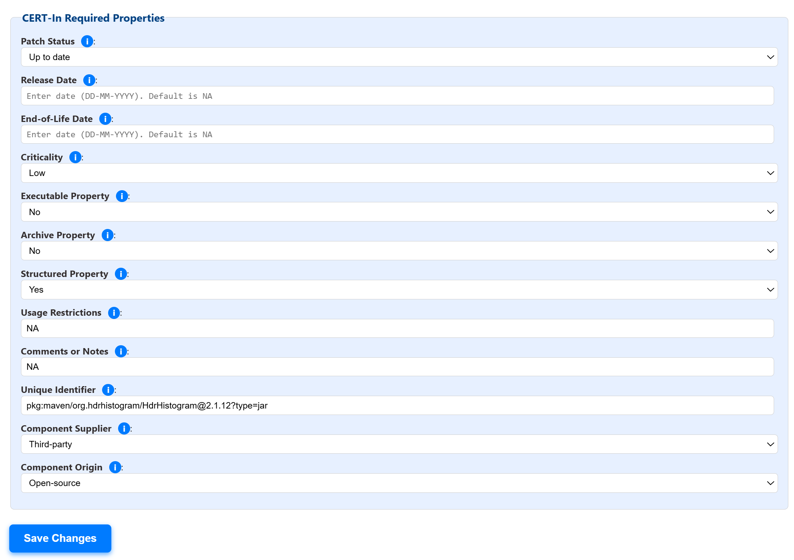
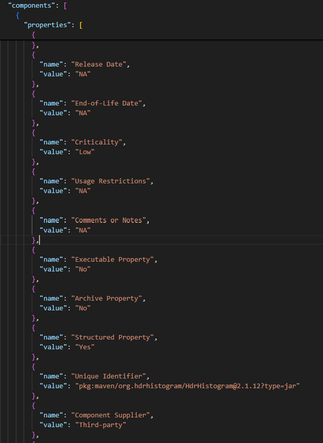

 <span style="font-size: 2em; vertical-align: middle;">CERT-In SBOM Mapper</span>

This project is created to help generate a Software Bill of Materials (SBOM) compliant with the CERT-In technical guidelines. The guideline mandates the following elements included in the SBOM:

- Component Name  
- Component Version  
- Component Description  
- Hashes  
- Vulnerabilities  
- Criticality  
- Timestamp  
- Unique Identifier  
- Component Origin  
- Component Dependencies  
- Patch Status  
- Release Date  
- End-of-Life Date  
- Usage Restrictions  
- Comments or Notes  
- Component Supplier  
- Executable Property  
- Archive Property  
- Structured Property  
- External References  

For detailed guidelines, refer to the official CERT-In document:  
[Technical Guidelines on SBOM by CERT-In](https://www.cert-in.org.in/PDF/TechnicalGuidelines-on-SBOM,QBOM&CBOM,AIBOM_and_HBOM_ver2.0.pdf)

---

## Why CERT-In SBOM Mapper?

While exploring few paid and open-source tools, we found it does not fully satisfy all the minimum elements required by the CERT-In guideline. This tool serves as an addon to existing SBOM generators by adding all missing fields and enables exporting the augmented SBOM in CycloneDX and Excel formats.

---

## Features

- Upload tool-generated CycloneDX SBOM files  
- Edit and complete missing mandatory fields as per CERT-In guidelines  
- Export the updated SBOM in CycloneDX JSON and Excel formats for compliance
- Background auto-population for CERT-In properties (Patch Status, Release Date, Criticality, etc.)

---

## Getting Started

### Prerequisites

- Node.js (v14 or newer recommended)  
- npm package manager
- Cyclonedx file v1.5

Optional but recommended:
- Create a `.env` file at project root (see below)

### Installation and Running

1. Clone this repository:  
`git clone https://github.com/surajkum4r/CERT-In-SBOM-Mapper`
2. Navigate into the project directory:  
`cd cert-in-sbom-mapper`
3. Install dependencies:  
`npm install`
4. Start the development server:  
`npm start`
5. Open [http://localhost:3000](http://localhost:3000) in your browser.

### Environment (.env)


```
# Enable fetch debug (alerts/logs) while testing
REACT_APP_DEBUG_FETCH=0

# Optional GitHub token; if not set, GitHub is skipped entirely
# REACT_APP_GITHUB_TOKEN=ghp_xxx
```

Notes:
- GitHub is only used for enrichment (stars, forks, repo license) and as a fallback for Release Date; skipping it does not affect Patch Status/Criticality.
- Set `REACT_APP_DEBUG_FETCH=1` while testing to see background fetch alerts and logs.

---

## How it work


1. Export SBOM file from any SCA tool and upload it to OWASP Dependency Track.
2. Export CycloneDX SBOM file and import into CERT-In SBOM Mapper.
3. Upload your tool-generated CycloneDX SBOM file.  
4. The app auto-populates CERT-In properties in the background (batching to avoid rate limits).  
5. Review and optionally edit any fields.  
6. Export the SBOM as JSON, CSV or Excel.

### What gets auto-populated

- Patch Status: via OSV (fixed versions) and registry latest version.  
  - Examples: `Update available (>= 2.8.9)`, `Update available (latest 1.2.3)`, `Up to date`.
- Release Date: from package registries (npm/PyPI/Maven); GitHub created_at as fallback when token is set.  
- Criticality: highest of:  
  1) SBOM `vulnerabilities[].ratings[].severity` matched by `affects[].ref` → component `bom-ref`  
  2) OSV CVSS score mapping  
  3) Count-based fallback (if needed)
- End-of-Life Date: from `endoflife.date` for known products (nodejs, python, java). Library EOL is usually not published.

### Considerations and limitations

- OSV may not always return severity or fixed versions immediately for new advisories; in such cases Criticality may be Unknown and Patch Status may show `Update available (>= NA)`.
- endoflife.date publishes product/platform EOL, not library EOL. Many Maven libraries legitimately have no EOL.
- GitHub calls are skipped if no token is set, to avoid 401/429 rate limits.
- Background fetching is batched; large SBOMs can take time to complete.

---

## Command-line companion: `certin-bom` (Python)

[`certin-bom-cli/`](certin-bom-cli/) contains a separate, scriptable tool for CI pipelines and
audits. It covers all five inventories in the CERT-In Guidelines v2.0 (SBOM, CBOM, QBOM, AIBOM
and HBOM):

- **Audit** any CycloneDX or SPDX BOM field by field against the CERT-In tables, with a CI gate
  (`validate --fail-under`).
- **Enrich** an SBOM to all 21 Table 5 fields. Every derived value records how it was obtained,
  and unknowns are declared explicitly.
- **Vulnerabilities** from OSV (including Debian, Ubuntu and Alpine packages), NVD by CPE, CISA KEV
  and EPSS, prioritised P0–P3. An offline database is available for air-gapped audits.
- **Cryptography inventory (CBOM)** from code, certificates and TLS endpoints, and a quantum-risk
  QBOM with a post-quantum migration plan.
- **Disclosure:** VEX and CSAF 2.0 output, public and private SBOM copies, and Ed25519 signatures.

```bash
cd certin-bom-cli
python3 -m venv .venv && source .venv/bin/activate
pip install -e '.[crypto]'
certin-bom validate your-sbom.json --md report.md
```

See [certin-bom-cli/README.md](certin-bom-cli/README.md) for full setup, NVD API key handling and
usage.

---

## Future Updates

- Additional ecosystems and data sources (NuGet, Maven SCM parsing improvements)
- Support for additional SBOM formats

---


## Screenshots






---

## Running with Docker

You can run CERT-In SBOM Mapper using Docker for easy setup and deployment.
### Clone local copy

```
git clone https://github.com/surajkum4r/CERT-In-SBOM-Mapper.git
```

```
cd cert-in-sbom-mapper
```
### Build the Docker image

```
docker build -t cert-in-sbom-mapper .
```

### Run the Docker container

```
docker run -p 3000:3000 cert-in-sbom-mapper
```

This will start the application and expose it on [http://localhost:3000](http://localhost:3000).

---
